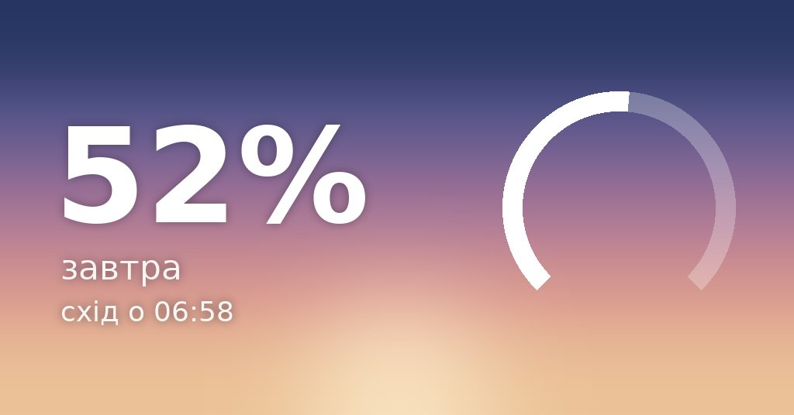
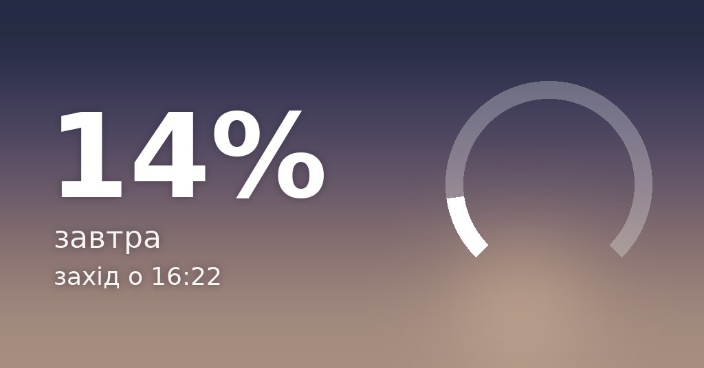
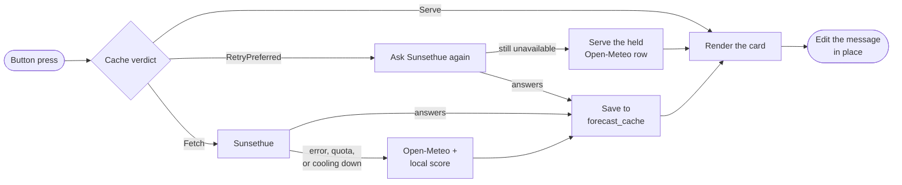
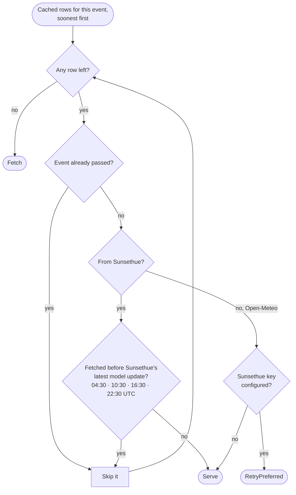
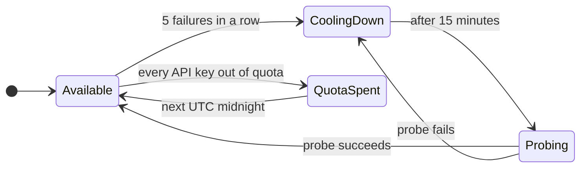
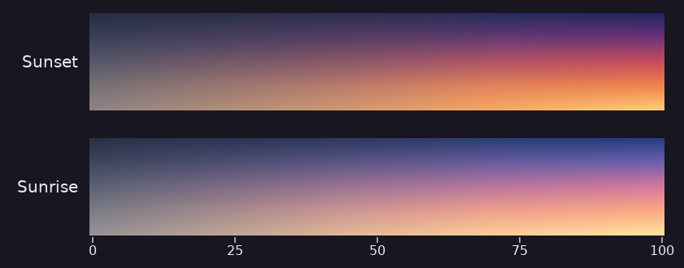
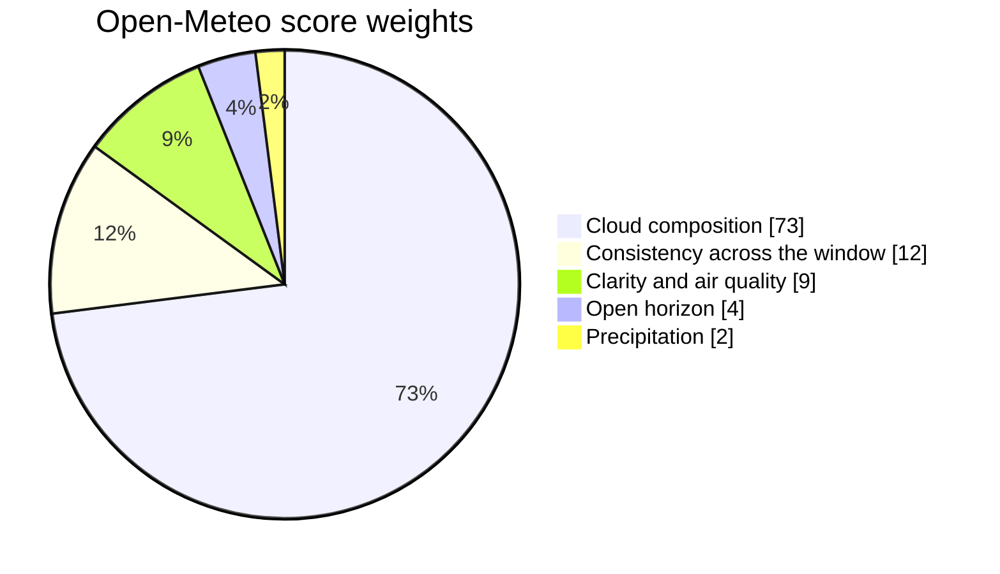

# Sunset Telegram Bot

A self-hosted Telegram bot that predicts whether today's sunset is likely to be worth watching.

<p align="center">
  
  
  
</p>

Every forecast arrives as a card like these: the score as a number and a gauge, the day and local time of the event, and a sky drawn for that score.

## Features

- Telegram long polling, no public webhook required.
- Postgres persistence through Docker Compose.
- Automatic Alembic migrations on startup.
- One-time Telegram location sharing.
- Automatic timezone detection from coordinates.
- Sunsethue forecast scores with Open-Meteo fallback.
- Automatic return to Sunsethue once it recovers from an outage.
- Numeric sunset score, local sunset time, and short explanation.
- Button-driven settings with validated manual input.
- Opt-in notifications before promising sunsets.
- Privacy-conscious logs that avoid user data.
- Sunrise forecasts on demand from the same pipeline.

## How It Works

### From button press to card

The three day buttons (Сьогодні, Завтра, Світанок) all run one pipeline. The cache decides first; a provider is only asked when the cache has nothing it can serve.



### Which cached forecast is served

The cache holds today's and tomorrow's row for each Solar Event (sunrise or sunset). The decision walks them soonest first:



An Open-Meteo row is *provisional*: it is shown, but Sunsethue is asked again the next time it is needed, so a score can improve between two checks.

### When Sunsethue keeps failing

Sunsethue is skipped for a while after repeated failures instead of being asked on every press. A spent daily quota waits for the next UTC day, since it will not recover sooner.



While Sunsethue is cooling down or out of quota, every forecast comes from Open-Meteo.

## Reading the Card

The sky behind the score is a function of the score, and it changes continuously: 44 and 45 look almost the same, while 15 and 85 look like different weather. Sunset runs from grey dusk to orange and violet; sunrise from grey dawn to pink and blue.

<p align="center">
  
</p>

With a Sunsethue key, the score is Sunsethue's own quality forecast. Without one, or while it is unavailable, the bot scores Open-Meteo's hourly weather around the event itself. That local score is a weighted blend of five factors, after which hard caps can only lower it: a high chance of rain caps it at 30–50, and thick low cloud at 35–55.



Regenerate the card and strip images after changing the card's look:

```bash
python .github/readme/make_images.py
```

## Run Locally

1. Create a bot with BotFather and get a Telegram token.
2. Copy `.env.example` to `.env`.
3. Fill in `TELEGRAM_BOT_TOKEN` and change the Postgres password.
4. Set `LOCATION_ENCRYPTION_KEY` to a stable secret and keep it unchanged.
5. Optionally set `SUNSETHUE_API_KEY` to use Sunsethue as the primary forecast provider. Set `SUNSETHUE_FALLBACK_API_KEY` if you want a second key to use after the primary key hits its daily quota.
6. Start the stack:

```bash
docker compose up -d --build
```

7. Open Telegram and send `/start` to the bot.

## Raspberry Pi Deployment

Clone this repository on the Pi, create `.env`, then run:

```bash
docker compose up -d --build
docker compose logs -f bot
```

The bot uses long polling, so the Pi only needs outbound internet access.

## Configuration

```env
NOTIFICATION_SCAN_INTERVAL_MINUTES=30
DEFAULT_NOTIFICATION_THRESHOLD=70
DEFAULT_NOTIFICATION_LEAD_TIME_MINUTES=90
FORECAST_CACHE_TTL_MINUTES=300
FORECAST_CACHE_RETENTION_DAYS=7
LOCATION_ENCRYPTION_KEY=replace-with-a-long-random-secret
SUNSETHUE_API_KEY=optional-api-key
SUNSETHUE_FALLBACK_API_KEY=optional-second-api-key
```

`LOCATION_ENCRYPTION_KEY` is used to encrypt latitude and longitude before storing them in Postgres. If this key changes, saved user locations cannot be decrypted and users must share location again.

When `SUNSETHUE_API_KEY` is configured, the bot sends saved coordinates to Sunsethue for sunset quality, time, direction, and magic-hour forecasts. If the primary key hits its daily quota, the bot retries with `SUNSETHUE_FALLBACK_API_KEY` when configured. If Sunsethue is unavailable, returns no model data, or no key is configured, the bot falls back to Open-Meteo and its local scoring logic. Cached Sunsethue forecasts are refreshed after the next expected model update time.

An Open-Meteo forecast stored because Sunsethue was unavailable is treated as provisional. The next time that forecast is needed, whether from `/today` or from the notification scan, the bot re-asks Sunsethue first and serves its answer if it has recovered; otherwise the stored Open-Meteo forecast is served unchanged. A score can therefore improve between two checks. When Sunsethue fails repeatedly the bot stops asking for a short cooldown, and when every API key has spent its daily quota it waits until the next UTC day instead.

The migration to encrypted coordinates removes existing plaintext latitude and longitude columns. Existing users should share their location again after upgrading.

## Database Credentials

`POSTGRES_PASSWORD` is read from `.env` in two independent places and both must
agree, or the bot cannot reach its own database: Compose interpolates it into the
`postgres` service, and the bot connects with `DATABASE_URL`, which embeds the
same password. `docker-compose.yml` declares no default for it — a weak fallback
that silently works is worse than a container that refuses to start.

Postgres reads `POSTGRES_PASSWORD` **only when it initialises a new data
directory**. On a stack that already has a volume, changing `.env` and recreating
the container does nothing: the database keeps the password it was born with and
the bot then fails to authenticate. Rotating on a running stack takes two steps,
in this order:

```bash
# 1. Change it inside the database, while the stack is still up.
docker compose exec -T postgres   psql -U "$POSTGRES_USER" -d "$POSTGRES_DB"   -c "ALTER USER \"$POSTGRES_USER\" WITH PASSWORD '<new password>';"

# 2. Update POSTGRES_PASSWORD *and* the password inside DATABASE_URL, then:
docker compose up -d
docker compose logs --tail 20 bot     # migrations run, then Start polling
```

Generate a password from an alphabet with no URL-reserved characters
(`openssl rand -hex 24`), or percent-encode it inside `DATABASE_URL`.

The published port is bound to `127.0.0.1`. The bot container reaches Postgres
over the Compose network and does not use the published port at all. Do not
republish it on `0.0.0.0`: on a host attached to a LAN or a VPN that makes the
database reachable and writable by every device on either. Coordinates are
encrypted at rest, but subscriber identifiers and settings are not, and write
access is enough to destroy the data.

## V1 Non-Goals

- No live location tracking.
- No multiple saved locations.
- No paid APIs.
- No public webhook deployment.
- No admin dashboard.
- No analytics.
- No HTTP health endpoint.
